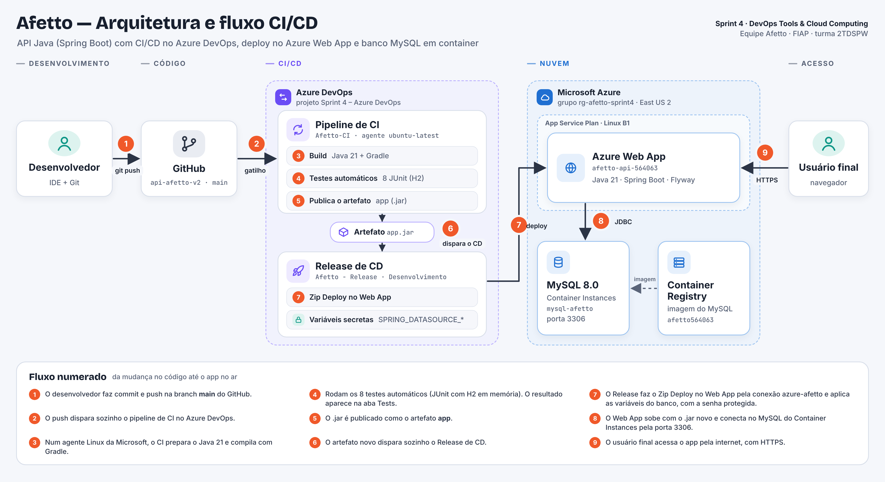

# 🐾 Afetto — Sprint 4: CI/CD com Azure DevOps

API REST do Afetto em Java (Spring Boot), com integração e entrega contínuas no **Azure DevOps**, deploy automático no **Azure Web App** e banco **MySQL** rodando em container na Azure.

## 👥 Integrantes

| Nome | RM | Turma |
|---|---|---|
| Gustavo Souto de Melo | RM558595 | 2TDSPW |
| Iago Liziero Pereira | RM564063 | 2TDSPW |
| Icaro José Dos Santos | RM562403 | 2TDSPW |
| Leonardo Barbosa Santos | RM558230 | 2TDSPW |

---

## 📌 Descrição da solução

O **Afetto** é uma plataforma de gestão de saúde animal que conecta tutores de pets a clínicas e veterinários, centralizando o cadastro dos pets, o histórico de atendimentos e o controle de vacinação. Esta API é o back-end da solução: cadastro e login de usuários, CRUD de pets e de vacinas, verificação do status de vacinação de cada pet e o cadastro de endereços.

Nesta Sprint, a API ganhou uma esteira de CI/CD completa no Azure DevOps. A cada alteração na branch `main`, o código é compilado, testado e empacotado automaticamente, e a nova versão é publicada no Azure Web App sem nenhum passo manual. Usuário, senha e URL do banco ficam fora do código, como variáveis protegidas da pipeline.

### 🧰 Stack

| Camada | Tecnologia |
|---|---|
| Linguagem e framework | Java 21, Spring Boot 4 (Web, Data JPA, Security, Validation, HATEOAS, Thymeleaf) |
| Build | Gradle (wrapper) |
| Banco de dados | MySQL 8.0 em container no Azure Container Instances, com migrations do Flyway |
| Testes automáticos | JUnit 5 e Spring Boot Test, com H2 em memória no perfil `test` |
| Documentação da API | springdoc-openapi (Swagger UI) |
| Código-fonte | GitHub (`iagoliziero/api-afetto-v2`, branch `main`) |
| CI/CD | Azure DevOps: pipeline de build (CI) e Release (CD) |
| Hospedagem | Azure Web App (App Service Linux, plano B1) |
| Imagem do banco | Azure Container Registry |

---

## 🏗️ Arquitetura e fluxo CI/CD



**Fluxo numerado**

1. O desenvolvedor faz commit e push na branch `main` do GitHub.
2. O push dispara sozinho o pipeline de CI no Azure DevOps.
3. Num agente Linux da Microsoft (`ubuntu-latest`), o CI prepara o Java 21 e compila com Gradle.
4. Rodam os 8 testes automáticos (JUnit com H2 em memória). O resultado aparece na aba **Tests**.
5. O `.jar` é publicado como o artefato `app`.
6. O artefato novo dispara sozinho o Release de CD.
7. O Release faz o Zip Deploy no Web App pela conexão de serviço `azure-afetto` e aplica as variáveis do banco, com a senha protegida.
8. O Web App sobe com o `.jar` novo, o Flyway valida o banco e a API conecta no MySQL do Container Instances pela porta 3306.
9. O usuário final acessa o app pela internet, com HTTPS.

**Onde cada ferramenta atua**

| Componente | Papel |
|---|---|
| GitHub | Guarda o código-fonte. O push na `main` é o gatilho da esteira |
| Azure DevOps · `Afetto-CI` | Build, testes automáticos e publicação do artefato |
| Azure DevOps · `Afetto - Release` | Deploy automático do artefato no Web App |
| Conexão de serviço `azure-afetto` | Dá ao Azure DevOps acesso à assinatura da Azure (Azure Resource Manager) |
| Azure Web App `afetto-api-564063` | Executa a API (Java 21, Linux) |
| Azure Container Instances `mysql-afetto` | Executa o banco MySQL 8.0 |
| Azure Container Registry `afetto564063` | Guarda a imagem do MySQL usada pelo container |

---

## 🔁 Pipelines no Azure DevOps

Projeto: **Sprint 4 – Azure DevOps** (organização `MR564063`, privado, Git, processo Agile).

### CI — `Afetto-CI`

Pipeline criada pelo editor clássico, com o código vindo direto do GitHub (`iagoliziero/api-afetto-v2`, branch `main`).

| Ordem | Tarefa | Configuração |
|---|---|---|
| 1 | Java tool installer | JDK 21, x64, pré-instalado no agente |
| 2 | Gradle | `./gradlew build`, publica os resultados em `**/build/test-results/test/TEST-*.xml` com o título "Testes de Código" |
| 3 | Copy files | Copia `**/build/libs/*.jar` (sem o `*-plain.jar`) para `$(Build.ArtifactStagingDirectory)` |
| 4 | Publish build artifacts | Publica o artefato `app` no Azure Pipelines |

- **Agente:** Azure Pipelines, `ubuntu-latest`
- **Gatilho:** integração contínua ligada na branch `main`
- **Número do build:** `$(date:yyyyMMdd)$(rev:.r)`

### CD — `Afetto - Release`

| Item | Configuração |
|---|---|
| Artefato | Build `Afetto-CI`, versão Latest, alias `Afetto - CI` |
| Gatilho | Continuous deployment trigger ligado: todo artefato novo cria um Release |
| Stage | `Desenvolvimento`, agente `ubuntu-latest` |
| Tarefa | Azure App Service deploy: conexão `azure-afetto`, Web App on Linux, `afetto-api-564063`, pacote `$(System.DefaultWorkingDirectory)/**/*.jar`, método Zip Deploy |
| App settings | `-SPRING_DATASOURCE_USERNAME "$(SPRING_DATASOURCE_USERNAME)" -SPRING_DATASOURCE_PASSWORD "$(SPRING_DATASOURCE_PASSWORD)" -SPRING_DATASOURCE_URL "$(SPRING_DATASOURCE_URL)"` |

### 🔒 Variáveis protegidas

| Variável | Onde | Proteção |
|---|---|---|
| `SPRING_DATASOURCE_URL` | Variables do Release (escopo Release) | — |
| `SPRING_DATASOURCE_USERNAME` | Variables do Release (escopo Release) | — |
| `SPRING_DATASOURCE_PASSWORD` | Variables do Release (escopo Release) | Secreta (cadeado): não aparece em logs nem na tela |

Nenhuma senha fica no código: o `application.properties` só lê variáveis de ambiente.

```properties
spring.datasource.url=${SPRING_DATASOURCE_URL}
spring.datasource.username=${SPRING_DATASOURCE_USERNAME}
spring.datasource.password=${SPRING_DATASOURCE_PASSWORD}
```

---

## ✅ Testes automáticos

São 8 testes, que sobem a aplicação inteira numa porta aleatória e chamam a API de verdade, com sessão de login:

| Classe | O que testa |
|---|---|
| `JavaAfettoApplicationTests` | A aplicação sobe sem erros |
| `PetApiTests` | CRUD completo do pet, validação de pet sem nome (400) e bloqueio de acesso sem login |
| `VacinaApiTests` | CRUD completo da vacina, status de vacinação (`ATENCAO` e `EM_DIA`) e validação de vacina sem pet (400) |

Os testes rodam com o perfil `test` (`src/test/resources/application-test.properties`), que troca o MySQL por um H2 em memória. Assim o CI não depende do banco da nuvem estar ligado.

Para rodar na máquina:

```bash
./gradlew test
```

---

## ☁️ Infraestrutura na Azure

Grupo de recursos `rg-afetto-sprint4`, região East US 2.

| Recurso | Nome | Detalhes |
|---|---|---|
| Container Registry | `afetto564063` | SKU Basic, guarda a imagem `mysql:8.0` |
| Container Instances | `mysql-afetto` | MySQL 8.0, porta 3306, banco `afettodb`, acesso por `mysql-afetto-564063.eastus2.azurecontainer.io` |
| App Service Plan | `plan-afetto` | Linux, B1 |
| Web App | `afetto-api-564063` | Java 21 (`JAVA:21-java21`), `https://afetto-api-564063.azurewebsites.net` |

### Como recriar a infraestrutura (Azure CLI)

```bash
RG="rg-afetto-sprint4"
LOCATION="eastus2"
ACR="afetto564063"
PLAN="plan-afetto"
WEBAPP="afetto-api-564063"

# a senha do banco é digitada na hora e não fica salva em nenhum arquivo
read -s -p "Senha do MySQL: " DB_PASSWORD; echo

az group create --name $RG --location $LOCATION

# registry com a imagem do MySQL
az acr create --resource-group $RG --name $ACR --sku Basic --admin-enabled true
az acr import --name $ACR --source docker.io/library/mysql:8.0 --image mysql:8.0
# se o Docker Hub limitar os downloads, adicione: --username <usuario-dockerhub> --password <token>

ACR_USER=$(az acr credential show --name $ACR --query username -o tsv)
ACR_PASS=$(az acr credential show --name $ACR --query "passwords[0].value" -o tsv)

# banco MySQL em container
az container create \
  --resource-group $RG \
  --name mysql-afetto \
  --image $ACR.azurecr.io/mysql:8.0 \
  --os-type Linux --cpu 1 --memory 1.5 \
  --ports 3306 \
  --dns-name-label mysql-afetto-564063 \
  --registry-login-server $ACR.azurecr.io \
  --registry-username $ACR_USER \
  --registry-password $ACR_PASS \
  --environment-variables MYSQL_DATABASE=afettodb \
  --secure-environment-variables MYSQL_ROOT_PASSWORD=$DB_PASSWORD

# plano e Web App Linux com Java 21
az appservice plan create --name $PLAN --resource-group $RG --is-linux --sku B1
az webapp create --name $WEBAPP --resource-group $RG --plan $PLAN --runtime "JAVA:21-java21"
```

A conexão com o banco é aplicada no Web App pelo próprio Release (App settings), a partir das variáveis protegidas da pipeline.

### Ligar e desligar entre os dias de uso (economia de crédito)

```bash
# ligar
az container start --resource-group $RG --name mysql-afetto
az appservice plan update --name $PLAN --resource-group $RG --sku B1
az webapp config set --name $WEBAPP --resource-group $RG --always-on true

# desligar
az container stop --resource-group $RG --name mysql-afetto
az webapp config set --name $WEBAPP --resource-group $RG --always-on false
az appservice plan update --name $PLAN --resource-group $RG --sku F1
```

---

## 🌐 Rotas

Base URL: `https://afetto-api-564063.azurewebsites.net`

### Telas
| Rota | Descrição |
|---|---|
| `/` | Página inicial |
| `/login` | Login |
| `/pets` | Pets do usuário |
| `/vacinas` | Vacinas dos pets |

### Autenticação
| Método | Rota | Descrição |
|---|---|---|
| POST | `/usuario` | Cria um novo usuário (tutor) |
| POST | `/login` | Autentica o usuário (retorna o cookie de sessão) |

### Pet
| Método | Rota | Descrição |
|---|---|---|
| POST | `/pet` | Cria um pet |
| GET | `/pet/{id}` | Busca um pet por ID |
| GET | `/pet` | Lista os pets, paginado |
| PUT | `/pet/{id}` | Atualiza um pet |
| DELETE | `/pet/{id}` | Remove um pet |
| GET | `/pet/{id}/status-vacinacao` | Status de vacinação do pet |

### Vacina
| Método | Rota | Descrição |
|---|---|---|
| POST | `/vacina` | Registra a aplicação de uma vacina |
| GET | `/vacina/{id}` | Busca uma vacina por ID |
| GET | `/vacina` | Lista as vacinas, paginado |
| PUT | `/vacina/{id}` | Atualiza um registro de vacina |
| DELETE | `/vacina/{id}` | Remove um registro de vacina |

### Usuário
| Método | Rota | Descrição |
|---|---|---|
| GET | `/usuario/me` | Dados do usuário logado |
| GET | `/usuario/{id}` | Busca um usuário por ID |
| GET | `/usuario` | Lista os usuários, paginado |
| PUT | `/usuario/{id}` | Atualiza um usuário |
| DELETE | `/usuario/{id}` | Remove um usuário |
| PATCH | `/usuario/{id}/role` | Altera o papel de acesso (ADMIN/USER) |
| GET | `/usuario/distancia` | Distância geográfica entre dois usuários |

Também há CRUD de endereço em `/pais`, `/estado`, `/cidade`, `/bairro`, `/logradouro` e `/endereco`.

> Documentação interativa completa em `/swagger-ui/index.html`.

---

## 🗄️ Banco de dados

As tabelas são criadas pelo Flyway (`src/main/resources/db/migration/V1__create_tables.sql`) na primeira subida da API. As principais para o CRUD são `TBL_USUARIO`, `TBL_PET` e `TBL_VACINA`.

Para conferir os dados direto no MySQL do container:

```bash
az container exec --resource-group rg-afetto-sprint4 --name mysql-afetto --exec-command "mysql -uroot -p"
```

```sql
USE afettodb;
SELECT * FROM TBL_PET;
SELECT * FROM TBL_VACINA;
```

---

## 🧪 Testando a esteira de ponta a ponta

1. Altere algo visível no código, por exemplo o título em `src/main/resources/templates/index.html`.
2. Faça commit e push na `main`.
3. No Azure DevOps, o `Afetto-CI` começa sozinho, roda os testes e publica o artefato.
4. Em seguida, um novo Release começa sozinho e faz o deploy.
5. Depois que o Release ficar verde, espere alguns minutos para o Java subir com o `.jar` novo e abra `https://afetto-api-564063.azurewebsites.net`.

---

## 🔗 Links

- 💻 Código-fonte: https://github.com/iagoliziero/api-afetto-v2
- 🔁 Projeto no Azure DevOps: https://dev.azure.com/MR564063/Sprint%204%20%E2%80%93%20Azure%20DevOps
- 🌐 App no ar: https://afetto-api-564063.azurewebsites.net
- 🎥 Vídeo da Sprint 4: https://www.youtube.com/watch?v=GWM6qBhcP9Q

---

## 📜 Sprints anteriores

Na Sprint 3, a API e o MySQL rodavam como containers no Azure Container Instances, com as imagens no Azure Container Registry e os segredos no Azure Key Vault. Os arquivos daquela entrega continuam no repositório: [`Dockerfile`](./Dockerfile), [`deploy-sprint3.sh`](./deploy-sprint3.sh) e [`script_bd.sql`](./script_bd.sql).